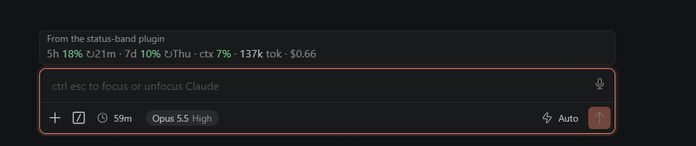

# status-band

A Claude Code mod that shows how much of your Claude usage you've spent, in one slim line above the prompt:



In a wider pane each figure gets a bar too:

```
5h ━───── 17% ↻31m · 7d ━───── 10% ↻Thu · ctx ━───── 7% · 67.6k tok · $0.60
```

- **5h / 7d**: your subscription's rate-limit windows, how full each is and when it resets (`31m`, `3h05m`, or the weekday). Shown only when your account reports them (a Pro or Max subscription, after the first reply).
- **ctx**: how much of the model's context window the conversation fills.
- **tok**: tokens summed over every model request this session (input, cache and output).
- **$**: the session's cost.

Bars and percentages turn amber at 50% and red at 80%. In narrow panes (under 76 columns) the bars drop out and the numbers stay. The figures update after each turn and whenever a plan window moves. It draws in the terminal, the desktop app and VS Code.

## Install

From a shell:

```
claude plugin marketplace add basilnewagesmb/status-band
claude plugin install status-band@claude-status-band
```

Or at the prompt of a Claude Code terminal session (the `claude` CLI; `/plugin` is not available in the VS Code chat panel, so use the shell commands above there):

```
/plugin marketplace add basilnewagesmb/status-band
/plugin install status-band@claude-status-band
```

`basilnewagesmb/status-band` is the GitHub repository; `claude-status-band` is the marketplace name it declares. Then reload the VS Code window or start a new session so the band loads.

### In VS Code

The Claude chat panel in VS Code has no `/plugin` command, so install from VS Code's terminal:

1. Open a terminal: `` Ctrl+` `` (or **Terminal → New Terminal**).
2. Add the marketplace and install the plugin:

   ```
   claude plugin marketplace add basilnewagesmb/status-band
   claude plugin install status-band@claude-status-band
   ```

   If the terminal says `claude` is not recognized, the CLI is not on your PATH. On Windows, use its full path instead (PowerShell):

   ```powershell
   & "$env:USERPROFILE\.local\bin\claude.exe" plugin marketplace add basilnewagesmb/status-band
   & "$env:USERPROFILE\.local\bin\claude.exe" plugin install status-band@claude-status-band
   ```

3. Reload VS Code: `Ctrl+Shift+P` → **Developer: Reload Window**.
4. Open the Claude panel and send a message. The usage band shows above the prompt.

### In the desktop app

Where `/plugin` does not run: click **+** next to the prompt box, then **Plugins**, **Add marketplace** with `basilnewagesmb/status-band`, then **Add plugin**.

## Update

To get a newer version, run these in a terminal (VS Code: `` Ctrl+` ``), then reload the window (`Ctrl+Shift+P` → **Developer: Reload Window**) or start a new session:

```
claude plugin marketplace update claude-status-band
claude plugin update status-band@claude-status-band
```

Full path on Windows, if `claude` is not on your PATH (PowerShell):

```powershell
& "$env:USERPROFILE\.local\bin\claude.exe" plugin marketplace update claude-status-band
& "$env:USERPROFILE\.local\bin\claude.exe" plugin update status-band@claude-status-band
```

The first command fetches the latest from GitHub; the second installs it. If the band still looks like the old version after reloading, the plugin's `version` was probably not raised: see **Publishing a new version** below.

## Develop

```
claude plugin validate .
claude plugin test .
```

### Publishing a new version

1. Raise `version` in [.claude-plugin/plugin.json](.claude-plugin/plugin.json) (for example `0.3.0` → `0.4.0`). `claude plugin update` compares versions, so without this, installed copies keep the old code.
2. Commit and push to `main` on `basilnewagesmb/status-band`.
3. Run the two commands under **Update** and reload.
